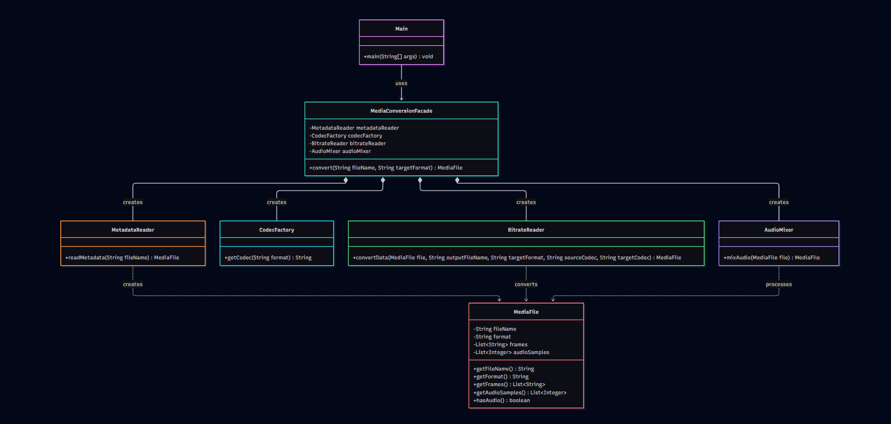

Media Conversion Facade
1. Project Description
   This project demonstrates the Facade Design Pattern using a media conversion system written in Java.
   The Facade Pattern is a structural design pattern that provides a simple interface to a complex subsystem. Instead of calling several classes separately, the client uses one method to start the conversion process.
   In this project, MediaConversionFacade coordinates the media conversion steps.
2. Objectives

   •	Understand the Facade Design Pattern

   •	Simplify interactions between multiple classes.

   •	Separate responsibilities between components.

   •	Practice object-oriented programming in Java.

   •	Handle invalid input using exceptions.

3. Technologies

   •	Java

   •	IntelliJ IDEA

   •	Mermaid for the UML class diagram

4. Project Structure
   Class	Responsibility
   Main	Starts the application and calls the Facade.
   MediaConversionFacade	Coordinates the conversion process.
   MetadataReader	Validates the file name and reads simulated metadata.
   CodecFactory	Selects a codec based on the file format.
   BitrateReader	Simulates video frame conversion.
   AudioMixer	Processes audio samples when audio is available.
   MediaFile	Stores the file name, format, video frames, and audio samples.
5. How It Works

   The conversion process follows these steps:

The client calls convert() in MediaConversionFacade.

MetadataReader validates the input and reads simulated file metadata.

CodecFactory selects the source and target codecs.

BitrateReader simulates video frame conversion.

AudioMixer processes audio samples if an audio track is available.

The Facade returns the resulting MediaFile.

The output file name is updated to match the target format.

6. Example Usage
   MediaConversionFacade facade = new MediaConversionFacade();
   MediaFile result = facade.convert("video.mp4", "avi");

System.out.println(result.getFileName());
System.out.println(result.getFormat());
Expected output includes:
video.avi
avi
7. UML Class Diagram
   
8. Error Handling
   The application handles invalid input, including:

   •	Empty or invalid file names.

   •	Unsupported source formats.

   •	Unsupported target formats.

   •	Identical source and target formats.

   These errors are reported using IllegalArgumentException and handled in Main.

9. Testing

   The application was tested with the following scenarios:

   •	Successful conversion from MP4 to AVI.

   •	Processing video frames and audio samples.

   •	Skipping audio processing when no audio track is available.

   •	Rejecting conversion when the source and target formats are identical.

10. Limitations

    This project is an educational simulation. It processes sample video frames and audio values stored in memory. It does not decode real media files or create actual converted video files.

11. Conclusion

    The project demonstrates how the Facade Pattern simplifies the use of a subsystem by providing one clear entry point. MediaConversionFacade hides the coordination details and makes the client code easier to understand.
